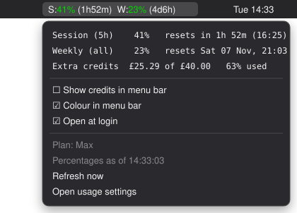
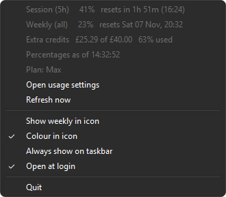
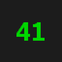
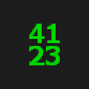

# claude-usage

See your Claude session and weekly usage limits at a glance, in the macOS menu bar or the Windows notification area. No more opening settings or running `/usage` to check what you have left.

<table>
  <tr>
    <th>macOS menu bar</th>
    <th>Windows tray menu</th>
  </tr>
  <tr>
    <td valign="top"></td>
    <td valign="top"></td>
  </tr>
</table>

<sub>Sample figures. The Windows image is a capture of the real menu. The macOS image is drawn from the plugin's actual output, not a screenshot.</sub>

## What you get

- **Session and weekly usage** as a percentage, with time until each one resets
- **Colour that shows how close you are**: green under 50%, amber from 50%, red from 80%
- **A menu with the detail**: exact reset times, extra-usage credit spend, your plan, and a Refresh now button
- **Nothing to set up**: it uses the sign-in Claude Code already has. No API key, no packages, one file of Python

## Install

You need **Claude Code, signed in** on the same machine, and **Python 3**.

### macOS

Needs [SwiftBar](https://github.com/swiftbar/SwiftBar), a free menu bar plugin host.

```sh
brew install --cask swiftbar
mkdir -p ~/SwiftBarPlugins
cp macos/claude-usage.10s.py ~/SwiftBarPlugins/
chmod +x ~/SwiftBarPlugins/claude-usage.10s.py
defaults write com.ameba.SwiftBar PluginDirectory -string "$HOME/SwiftBarPlugins"
open /Applications/SwiftBar.app
```

When macOS asks whether SwiftBar may read `Claude Code-credentials`, choose **Always Allow**. Full instructions, including installing without Homebrew: [macos/README.md](macos/README.md)

### Windows

Copy `windows/claude-usage-tray.pyw` anywhere and double-click it, or:

```powershell
Start-Process pythonw.exe -ArgumentList '"C:\path\to\claude-usage-tray.pyw"'
```

It starts with Windows from then on. New tray icons hide behind the `^` arrow, so right-click it and choose **Always show on taskbar**. More detail: [windows/README.md](windows/README.md)

## Reading the display

Both show your session usage by default. Turn on **Show weekly in icon** (Windows) or **Show weekly in menu bar** (macOS) to add the weekly figure.

| Icon | macOS | Meaning |
|:---:|---|---|
|  | `S:41%` | Plenty left |
|  | `S:78%` | Over half used |
|  | `S:96%` | Nearly out |
|  | `S:41% W:23%` | Session and weekly together |
|  | `S:--` | Not known right now (see below) |

**A figure that loses its colour is out of date.** After 15 minutes without a successful update the colour comes off (grey on Windows, plain text on macOS), so an old reading never looks healthy. On macOS a `⋯` after the figures means they are a few minutes old.

**`--` means it will not guess.** If your usage window reset while the figures could not be updated, the old number no longer applies, so it shows `--` until the next update instead of a made-up `0`.

## Troubleshooting

Open the menu first. When something is wrong, it says why there.

| You see | What to do |
|---|---|
| `token expired, run Claude Code in a terminal to refresh it` | Run `claude` in a terminal. The sign-in token lasts about 8 hours and only the Claude Code CLI renews it, not claude.ai in the browser or the desktop app. The figures come back within 90 seconds, with no restart needed |
| `token rejected, ...` | The same fix. If running `claude` does not clear it, sign in again with `/login` inside Claude Code |
| `rate limited, retrying at ...` | Nothing. Claude Code checks the same limit, so the two sometimes collide. It recovers on its own, usually within 5 minutes |
| Nothing in the menu bar (macOS) | The keychain prompt is probably hidden behind another window. Also check that the plugin folder is not a hidden folder like `~/.swiftbar` |
| No icon (Windows) | Look behind the `^` arrow in the taskbar |

Every attempt is logged as one JSON line in `~/.config/swiftbar-claude-usage/log.jsonl` (macOS) or `%LOCALAPPDATA%\claude-usage-tray\log.jsonl` (Windows). Include the last 20 lines if you report a problem.

## Good to know

- **It uses an undocumented endpoint.** The figures come from the same internal API that Claude Code's `/usage` uses. If it changes, the display shows `--` and the reason in the menu, and your menu bar or taskbar keeps working
- **It checks gently.** The display redraws every 10 seconds, but it asks the server at most once every 90 seconds, because the endpoint allows only a few calls before refusing for 5 minutes. Refresh now skips the wait
- **Your token stays on your machine.** It is sent only to `api.anthropic.com`. On Windows, Claude Code stores the token as a plain file in `%USERPROFILE%\.claude\`. That is Claude Code's choice, and this app does not change it
- **Uninstalling** means deleting the file and its settings folder. See the platform READMEs for the exact commands

## Further reading

- [How it works](docs/how-it-works.md): measured rate limits, pacing, and hardening
- [macos/README.md](macos/README.md) and [windows/README.md](windows/README.md): settings, files, the statusline sidecar format, and platform details
